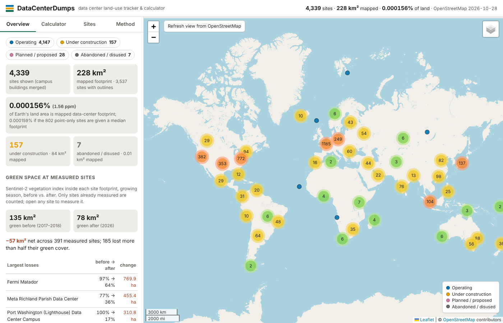

# DataCenterDumps

**Data center land-use tracker and calculator.** Every data center in
OpenStreetMap on one map: operating, under construction, planned, and
abandoned; how much land they cover, as a share of any country, state or map
view; and how much green space each site had before it was built, measured
from Sentinel-2 satellite imagery. A [SatDump](https://github.com/SatDump/SatDump)
ingest lets you add regional vegetation readings from satellites you receive
yourself.

**Live: <https://datacenters.rooted.wang>**



## Run it

```sh
python3 -m http.server -d web 8000
# open http://localhost:8000
```

`web/` is a static site with no build step. Leaflet, Leaflet.markercluster and
geotiff.js are vendored in `web/vendor/`; fonts are the system's own. It can be
served by GitHub Pages, Cloudflare Pages or any static host.

## What you get

| Tab | Does |
|---|---|
| Overview | Totals by status, mapped footprint, share of Earth's land, green space before vs. after at measured sites, countries ranked by land share, SatDump passes |
| Calculator | Pick world, a country, a state/province (US, Canada, Australia, Brazil, China, India, Indonesia, Russia, South Africa) or the current map view. Choose statuses, estimate point-only sites, apply a land-take multiplier. Returns % of land, ppm, km², acres |
| Sites | Search by name, operator, city, country; sort by footprint or green space lost; export CSV / GeoJSON of the filtered set |
| Site | Status and the tag that set it, footprint, operator, dates, links; Sentinel-2 green space before/after (pre-measured or **measured live in the browser**); imagery swipe between any two years 2016–2025 or current high-resolution imagery |
| Map | Clustered markers, footprints from zoom 11, basemaps (OpenStreetMap, Esri imagery, yearly Sentinel-2 mosaics), **Refresh view from OpenStreetMap** for live data in the current view, shareable URLs (`#map=z/lat/lon&site=way/123`) |

## Pipeline

```
pipeline/fetch_osm.py      Overpass API -> data/raw/          (standard library only)
pipeline/build_sites.py    raw -> web/data/sites.geojson, regions.json, meta.json
pipeline/green_space.py    Sentinel-2 L2A -> data/green_cache.json (then rerun build_sites.py)
pipeline/satdump_ingest.py SatDump GeoTIFF -> web/data/satdump/
```

```sh
pip install -r requirements.txt
python3 pipeline/fetch_osm.py            # ~1–2 min for exact tags; name search is tiled and slow on busy days
python3 pipeline/build_sites.py
python3 pipeline/green_space.py --top 200   # every non-operating site + the 200 largest operating ones
python3 pipeline/build_sites.py
```

`.github/workflows/refresh-data.yml` does this every Monday and commits the
result; `test.yml` runs the tests on every push.

### Method, in brief

- **Sites**: `telecom=data_center`, `building=data_center`, lifecycle prefixes
  (`construction:`, `proposed:`, `planned:`, `disused:`, `abandoned:`, `was:`,
  `removed:`, `demolished:`, `razed:`), `industrial=data_center`, plus
  construction / industrial / brownfield / greenfield land whose name says
  "data center" (English, German, French, Spanish).
- **Status** comes from those tags; each site displays the deciding tag.
- **Footprint**: geodesic area of the outline (WGS84 ellipsoid). Buildings
  inside a mapped campus are kept on the map but counted once.
- **Land share**: footprint ÷ Natural Earth 1:50m region area.
- **Green space**: Sentinel-2 Level-2A, growing season (May 15–Sep 30 north,
  Nov 15–Mar 31 south, whole year within 15° of the equator), least-cloudy
  scenes, cloud/shadow/cirrus removed with the scene classification band,
  vegetation index ≥ 0.3 counted as green, median of up to two scenes, inside
  the footprint (or a 150 m circle for point-only sites). The browser and
  Python implementations return identical numbers for the same site.
- **SatDump**: see [docs/SATDUMP.md](docs/SATDUMP.md).

### Limits worth knowing

- OpenStreetMap is the census. Coverage is strongest in Europe and North
  America; many sites are points without outlines; cancelled projects that
  never broke ground are rarely mapped, so "abandoned" undercounts.
- Mapped footprint is not acquired land; the calculator's multiplier exists
  for that gap.
- The vegetation index measures living plants, so lawns count as green and
  dormant grassland may not.

## Tests

```sh
python3 -m pytest -q tests && node tests/geo.test.mjs
```

## Sources and licences

- Code: MIT (see `LICENSE`).
- Site data: © OpenStreetMap contributors, ODbL 1.0.
- Sentinel-2: contains modified Copernicus Sentinel data, via Element 84
  Earth Search on AWS Open Data.
- Sentinel-2 cloudless mosaics: EOX IT Services GmbH (2016 CC BY 4.0; 2017
  onward CC BY-NC-SA 4.0, so non-commercial use).
- Boundaries: Natural Earth, public domain.
- Land-take examples in the calculator: Missouri Science & Technology Policy
  Initiative, "Data center land use" (2026).
- SatDump is GPL-3.0 and is not bundled; this project ships only preset JSON
  for it and reads its GeoTIFF output.

Built by Briar Morgan Greenway / ThinkWell Labs.
